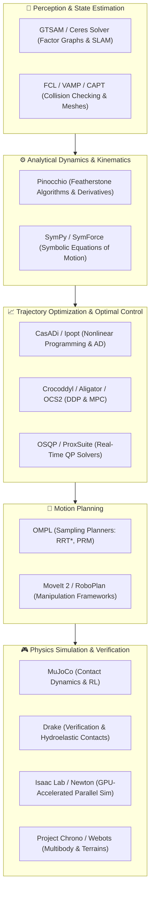

  

  
  
  
  
  
  
  

---

# 🤖 Awesome Robotics Scientific Computing

> 🚀 **A curated directory of SaaS platforms, enterprise simulation suites, and high-performance open-source numerical libraries powering modern robotics.**  
> *Covering rigid body dynamics, nonlinear trajectory optimization, sampling-based motion planning, differentiable physics engines, and factor graph sensor fusion.*

Robotics scientific computing constitutes the numerical and mathematical backbone of modern autonomy. These tools provide the analytical algorithms, solver architectures, and physics abstractions needed to model, simulate, optimize, and control complex articulated robotic systems — from humanoid bipedal locomotion and quadrupeds to multi-axis industrial manipulators and autonomous mobile platforms.

---

## 📑 Table of Contents

- [🌐 Sector Overview & Market Dynamics](#-sector-overview--market-dynamics)
- [🏢 SaaS & Hosted Commercial Platforms](#-saas--hosted-commercial-platforms)
- [🚀 Open-Source GitHub Projects (Sorted by Stars)](#-open-source-github-projects-sorted-by-stars)
- [🧩 Modern Robotics Computational Stack](#-modern-robotics-computational-stack)
- [🤝 How to Contribute](#-how-to-contribute)
- [📈 Star History](#-star-history)
- [💖 Support & Community](#-support--community)
- [📜 Disclaimer](#-disclaimer)

---

## 🌐 Sector Overview & Market Dynamics

The global robotics software, simulation, and scientific computing sector is estimated at **$18.5 Billion in 2025/2026** and is projected to expand beyond **$45 Billion by 2032**, demonstrating a compound annual growth rate (**CAGR of ~14.2%**). 

The industry exhibits a distinctive **two-tiered market dynamic**:
- **Enterprise CAE & Multiphysics Layer (Highly Concentrated / Oligopoly)**: Heavy-duty system simulation, finite element modeling, and automotive/aerospace certification remain concentrated among multi-billion-dollar conglomerates (Siemens, Ansys, Dassault Systèmes, Altair, MathWorks). These platforms command high switching costs, proprietary CAD integrations, and long-term enterprise licensing cycles.
- **Modern Algorithmic & AI Robotics Layer (Moderately to Highly Fragmented)**: The computational frontier — including analytical rigid body Featherstone algorithms, differentiable GPU simulation, nonlinear Model Predictive Control (NMPC), and real-time motion planning — is vigorously fragmented and led by academic institutions (Inria, MIT, ETH Zurich, Carnegie Mellon, Rice) and cutting-edge industrial AI labs (Google DeepMind, NVIDIA, Toyota Research Institute). Modern autonomous engineering stacks increasingly combine best-of-breed open-source numerical engines (e.g., Pinocchio + CasADi + OMPL + GTSAM) rather than committing to closed vendor ecosystems.

---

## 🏢 SaaS & Hosted Commercial Platforms

The following table summarizes notable commercial software platforms and hosted simulation suites for robotics scientific computing, sorted in descending order by estimated company valuation/annual revenue.

| 🏢 Platform / Product | 📊 Company Size (Valuation / Revenue) | 💰 Starting Tier Pricing | 🎁 Free Tier & Trial Limits | 🎯 Key Capabilities & Robotics Applications |
| :--- | :--- | :--- | :--- | :--- |
| **[Siemens Simcenter Amesim](https://plm.sw.siemens.com/en-US/simcenter/systems-simulation/amesim/)** | **~$150B Market Cap** *(Siemens AG, ~$85B Rev)* | **$10,800 / year** *(~$900/mo named user via Siemens Xcelerator SaaS)* | **30-Day Free Cloud Trial** *(Access to preconfigured mechatronic models; free perpetual Amesim Student Edition for verified university students)* | Multi-domain mechatronic system simulation, hydraulic/pneumatic actuator dynamics, Hardware-in-the-Loop (HiL) testing, and powertrain modeling. |
| **[Ansys Motion](https://www.ansys.com/products/structures/ansys-motion)** | **~$35B Valuation** *(Ansys Inc. / Synopsys, ~$2.3B Rev)* | **$12,500 / year** *(Commercial standalone seat; or $4,950 per 5,000 core-hours on Ansys Cloud)* | **30-Day Full Commercial Trial** *(Full GUI & solver access upon sales validation; Ansys Student free tier limited to 128k mesh elements)* | Multibody dynamics (MBD) engine for rigid and flexible bodies, high-frequency drivetrain vibration analysis, and robot link stress fatigue. |
| **[Altair MotionSolve](https://altair.com/motionsolve)** | **~$10.6B Valuation** *(Acquired by Siemens, ~$650M Rev)* | **$5,000 / year** *(Base pack of 50 Altair HyperWorks Units [HWUs] annual subscription)* | **30-Day Commercial Evaluation** *(Full HyperWorks suite access; free 1-year renewable Altair Student Edition limited to 100k nodes)* | 3D mechanical multibody dynamics, nonlinear contact mechanics, co-simulation with MATLAB/Simulink, and automated structural optimization. |
| **[MathWorks Robotics System Toolbox](https://www.mathworks.com/products/robotics.html)** | **~$1.5B Revenue** *(The MathWorks, Inc. - Private)* | **$3,800 / year** *($2,350/yr MATLAB base + $1,450/yr Robotics Toolbox; or $354/yr Home license)* | **30-Day Full Feature Free Trial** *(Unrestricted access to MATLAB, Simulink, and Robotics System Toolbox with complete documentation)* | Rigid body tree modeling, forward/inverse kinematics, inverse dynamics, ROS/ROS 2 node integration, and Gazebo co-simulation. |
| **[COMSOL Multiphysics](https://www.comsol.com/)** | **~$250M Revenue** *(COMSOL AB - Private)* | **$11,990 perpetual** *(Base named-user license + $2,398/yr maintenance; or $1,995 academic license)* | **14-Day Free Evaluation** *(Full solver suite unlocked with technical support upon direct request; free COMSOL Model Manager access)* | Coupled multiphysics modeling (electromagnetic, thermal, structural mechanics), piezoelectric actuator simulation, and flexible body kinematics. |
| **[Gurobi Optimizer](https://www.gurobi.com/)** | **~$120M Revenue** *(Gurobi Optimization LLC - Private)* | **$11,490 / year** *(Named-user commercial subscription; floating network seat at $16,950/yr)* | **Free Academic Plan (Full)** *(100% free full-featured perpetual license for accredited universities; 30-day commercial trial; restricted size free trial [2k variables/constraints])* | World-leading Mixed-Integer Linear & Quadratic Programming (MILP/MIQP) solver for robot path scheduling, task allocation, and footholds. |
| **[Wolfram Mathematica](https://www.wolfram.com/mathematica/)** | **~$60M Revenue** *(Wolfram Research - Private)* | **$1,865 / year** *(Standard commercial subscription or $185/mo; personal license from $354/yr)* | **15-Day Free Trial** *(Full access to 6,000+ Wolfram Language functions, symbolic differentiation, and Wolfram Cloud notebooks)* | Computer algebra and symbolic mathematics for analytical Jacobian derivation, Coriolis matrix computation, and nonlinear control law design. |

---

## 🚀 Open-Source GitHub Projects (Sorted by Stars)

Every major open-source numerical library, physics simulation engine, trajectory optimizer, and motion planning framework in robotics — **ranked strictly by GitHub stargazers count (descending)**.

---

### 1. [MuJoCo](https://github.com/google-deepmind/mujoco) 
> **Multi-Joint dynamics with Contact** — The gold standard for contact-rich manipulation and reinforcement learning.
- **Organization**: Google DeepMind
- **License**: Apache-2.0
- **Language**: C / C++ / Python bindings
- **Key Features**: Convex contact model formulation, depth-first kinematic tree representation, generalized coordinate dynamics, and the MuJoCo Menagerie model repository.

---

### 2. [SciPy](https://github.com/scipy/scipy) 
> **Fundamental numerical algorithms for scientific computing in Python.**
- **Organization**: SciPy Developers
- **License**: BSD-3-Clause
- **Language**: Python / C / C++ / Cython
- **Key Features**: General-purpose nonlinear optimization (`scipy.optimize`), numerical integration, differential equation solvers, sparse linear algebra, and spatial geometric algorithms.

---

### 3. [SymPy](https://github.com/sympy/sympy) 
> **Symbolic mathematics library for Python.**
- **Organization**: SymPy Development Team
- **License**: BSD-3-Clause
- **Language**: Python
- **Key Features**: Analytical kinematics and dynamics formulation (`sympy.physics.mechanics`), Kane's and Lagrange's equations of motion derivation, analytical Jacobians, and automated C code generation.

---

### 4. [Bullet Physics / PyBullet](https://github.com/bulletphysics/bullet3) 
> **Real-time multi-physics simulation engine for robotics, reinforcement learning, and gaming.**
- **Organization**: Bullet Physics SDK
- **License**: zlib / MIT
- **Language**: C++ / Python bindings
- **Key Features**: Articulated body Featherstone dynamics, fast continuous collision detection, inverse kinematics, URDF/SDF parsing, and ubiquitous Gym RL environment support.

---

### 5. [Isaac Lab](https://github.com/isaac-sim/IsaacLab) 
> **Unified, modular framework for robot learning powered by NVIDIA Isaac Sim and Omniverse.**
- **Organization**: NVIDIA Omniverse / Isaac Sim
- **License**: BSD-3-Clause
- **Language**: Python / C++
- **Key Features**: Massively parallel GPU-accelerated rigid-body simulation on NVIDIA PhysX 5, domain randomization, reinforcement and imitation learning pipelines for bipedal and dexterous manipulation.

---

### 6. [Newton (Physics)](https://github.com/newton-physics/newton) 
> **GPU-accelerated physics simulation engine built on NVIDIA Warp, specifically targeting roboticists.**
- **Organization**: Newton Physics
- **License**: Apache-2.0
- **Language**: Python / CUDA
- **Key Features**: Differentiable simulation kernels, spatial vector algebra, GPU-parallelized rigid body contact dynamics, and native compatibility with PyTorch training loops.

---

### 7. [Webots](https://github.com/cyberbotics/webots) 
> **Full-featured open-source 3D robot simulator for industrial and academic research.**
- **Organization**: Cyberbotics
- **License**: Apache-2.0
- **Language**: C / C++ / Python / Java / ROS
- **Key Features**: ODE dynamics engine, realistic sensor models (LiDAR, cameras, IMUs, range finders), full robot cross-compilation capabilities, and tight ROS/ROS 2 integration.

---

### 8. [Ceres Solver](https://github.com/ceres-solver/ceres-solver) 
> **Google's production-grade nonlinear least-squares and unconstrained optimization library.**
- **Organization**: Google
- **License**: Apache-2.0
- **Language**: C++
- **Key Features**: Automatic differentiation via dual numbers, Levenberg-Marquardt and Dogleg solvers, bundle adjustment, SLAM backend optimization, and sensor-to-sensor extrinsic calibration.

---

### 9. [Drake](https://github.com/RobotLocomotion/drake) 
> **Model-based design, simulation, and verification toolbox for robotics.**
- **Organization**: MIT Robot Locomotion Group / Toyota Research Institute (TRI)
- **License**: BSD-3-Clause
- **Language**: C++ / Python (`pydrake`)
- **Key Features**: Mathematical program formulations (Convex, Quadratic, SOCP, Mixed-Integer, Nonlinear), hydroelastic contact models, trajectory optimization via direct collocation, and formal system verification.

---

### 10. [Pinocchio](https://github.com/stack-of-tasks/pinocchio) 
> **The world reference library for fast rigid body dynamics and its analytical derivatives.**
- **Organization**: Inria / LAAS-CNRS (Stack of Tasks)
- **License**: BSD-2-Clause
- **Language**: C++ / Python bindings
- **Key Features**: Implementation of Roy Featherstone's spatial algebra (RNEA, ABA, CRBA), analytical derivatives of forward/inverse dynamics, constrained articulated dynamics, and GPU execution via modern C++ templates.

---

### 11. [GTSAM](https://github.com/borglab/gtsam) 
> **Georgia Tech Smoothing and Mapping library — Factor graphs for sensor fusion and estimation.**
- **Organization**: Borg Lab (Georgia Tech)
- **License**: BSD-3-Clause
- **Language**: C++ / Python bindings
- **Key Features**: Factor graph optimization based on Bayes networks, visual odometry, SLAM backends, continuous-time motion trajectory optimization, and iSAM2 incremental updates.

---

### 12. [Brax](https://github.com/google/brax) 
> **Differentiable physics engine written in JAX for massively parallel reinforcement learning.**
- **Organization**: Google
- **License**: Apache-2.0
- **Language**: Python (JAX)
- **Key Features**: Millions of physics simulation steps per second directly on TPUs and GPUs, seamless integration with automatic differentiation, and analytic policy gradients.

---

### 13. [mjlab](https://github.com/mujocolab/mjlab) 
> **Isaac Lab API powered by MuJoCo-Warp for robotics research.**
- **Organization**: MuJoCo Lab
- **License**: Apache-2.0
- **Language**: Python / Warp
- **Key Features**: Recreates Isaac Lab environments using MuJoCo physics coupled with NVIDIA Warp GPU acceleration for high-throughput RL and control.

---

### 14. [Project Chrono](https://github.com/projectchrono/chrono) 
> **High-performance multi-physics simulation infrastructure.**
- **Organization**: Project Chrono
- **License**: BSD-3-Clause
- **Language**: C++ / Python (`PyChrono`)
- **Key Features**: Rigid and flexible multibody dynamics, granular terrain interactions, finite element analysis (FEA), vehicle dynamics (`Chrono::Vehicle`), and Fluid-Solid Interaction (FSI).

---

### 15. [CasADi](https://github.com/casadi/casadi) 
> **Symbolic framework for nonlinear optimization and algorithmic differentiation.**
- **Organization**: CasADi Developers
- **License**: LGPL-3.0
- **Language**: C++ / Python / MATLAB
- **Key Features**: Forward and reverse mode AD on sparse matrix computational graphs, self-contained standalone C-code generation, and seamless integration with IPOPT, SNOPT, and OSQP for NMPC.

---

### 16. [OSQP](https://github.com/osqp/osqp) 
> **The Operator Splitting QP Solver — Embedded convex quadratic programming.**
- **Organization**: OSQP Development Team
- **License**: Apache-2.0
- **Language**: C / C++ / Python / Rust / Julia
- **Key Features**: Alternating Direction Method of Multipliers (ADMM), matrix-free operations, embedded micro-controller deployment, and the primary QP solver inside modern robotics Model Predictive Control.

---

### 17. [OMPL (Open Motion Planning Library)](https://github.com/ompl/ompl) 
> **The leading sampling-based motion planning library.**
- **Organization**: Kavraki Lab (Rice University)
- **License**: BSD-3-Clause
- **Language**: C++ / Python bindings
- **Key Features**: Implementation of RRT, RRT*, PRM, EST, KPIECE, constrained manifold motion planning, and SIMD-accelerated collision checking via VAMP in OMPL 2.0.

---

### 18. [MoveIt 2](https://github.com/moveit/moveit2) 
> **The open-source robotic manipulation framework for ROS 2.**
- **Organization**: MoveIt / PickNik Robotics
- **License**: BSD-3-Clause
- **Language**: C++ / Python
- **Key Features**: Motion planning pipeline wrapping OMPL and Pilz, collision scene monitoring, inverse kinematics plugins (KDL, BioIK), and trajectory execution control.

---

### 19. [Theseus](https://github.com/facebookresearch/theseus) 
> **Differentiable nonlinear least squares optimization library built on PyTorch.**
- **Organization**: Meta AI (FAIR)
- **License**: MIT
- **Language**: Python (PyTorch) / CUDA
- **Key Features**: Embedding structured optimization layers (kinematics, SE(3) manifolds, factor graphs, SLAM) directly inside deep neural network training loops.

---

### 20. [Ipopt](https://github.com/coin-or/Ipopt) 
> **Interior Point Optimizer for large-scale continuous nonlinear programming.**
- **Organization**: COIN-OR
- **License**: EPL-2.0
- **Language**: C++ / Fortran / C
- **Key Features**: Primal-dual interior point algorithm with filter line search; the fundamental NLP solver integrated inside CasADi, Drake, and general trajectory optimization stacks.

---

### 21. [FCL (Flexible Collision Library)](https://github.com/flexible-collision-library/fcl) 
> **Fast proximity computation and collision detection library for robotics.**
- **Organization**: Flexible Collision Library
- **License**: BSD-3-Clause
- **Language**: C++
- **Key Features**: Collision queries, exact distance computation, continuous collision detection (CCD), and contact point/normal estimation on bounding volume hierarchies (BVH).

---

### 22. [SymForce](https://github.com/symforce-org/symforce) 
> **Fast symbolic computation, code generation, and nonlinear optimization for robotics.**
- **Organization**: Skydio
- **License**: Apache-2.0
- **Language**: Python / C++
- **Key Features**: Combines SymPy ease-of-prototyping with high-performance C++ code generation, Lie group operations, and GPU-compatible real-time vision-based control.

---

### 23. [Gazebo Sim (GZ Sim)](https://github.com/gazebosim/gz-sim) 
> **Next-generation open-source multi-physics robotics simulator.**
- **Organization**: Open Robotics / Gazebo Sim
- **License**: Apache-2.0
- **Language**: C++ / Python
- **Key Features**: Multi-robot simulation, pluggable physics engine architecture (DART, Bullet, TPE), sensor simulation, distributed networking, and ROS 2 communication.

---

### 24. [OCS2](https://github.com/leggedrobotics/ocs2) 
> **Optimal Control for Switched Systems — High-performance MPC for legged robots.**
- **Organization**: Robotic Systems Lab (ETH Zurich)
- **License**: BSD-3-Clause
- **Language**: C++
- **Key Features**: Sequential Linear Quadratic (SLQ) and Multiple-Shooting Differential Dynamic Programming (DDP) for hybrid switched systems, quadrupeds, and bipedal locomotion.

---

### 25. [JAX-MD](https://github.com/jax-md/jax-md) 
> **Differentiable physics and particle dynamics in JAX.**
- **Organization**: JAX-MD Team (Google Research)
- **License**: Apache-2.0
- **Language**: Python (JAX)
- **Key Features**: End-to-end differentiable physical simulation, GPU spatial partitioning, and blending neural network learned dynamics with classical equations of motion.

---

### 26. [Crocoddyl](https://github.com/loco-3d/crocoddyl) 
> **Optimal control and Model Predictive Control framework for complex robotics platforms.**
- **Organization**: Loco-3D (Inria / LAAS-CNRS)
- **License**: BSD-3-Clause
- **Language**: C++ / Python bindings
- **Key Features**: Highly efficient Feasibility-driven Differential Dynamic Programming (FDDP), Box-FDDP for bound constraints, multi-contact planning, and built-in Pinocchio integration.

---

### 27. [DART](https://github.com/dartsim/dart) 
> **Dynamic Animation and Robotics Toolkit.**
- **Organization**: DART Development Group (Georgia Tech / Carnegie Mellon)
- **License**: BSD-2-Clause
- **Language**: C++20 / Python bindings
- **Key Features**: Articulated body Featherstone dynamics, constraint-based contact and friction calculations using LCP solvers, and full kinematic chains for biomechanics and robotics.

---

### 28. [VAMP](https://github.com/KavrakiLab/vamp) 
> **SIMD-accelerated collision checking and forward kinematics for robot motion planning.**
- **Organization**: Kavraki Lab (Rice University)
- **License**: BSD-3-Clause
- **Language**: C++
- **Key Features**: AVX-512 and AVX2 vectorization achieving kilohertz collision checking throughput; integrated directly as the acceleration backend in OMPL 2.0.

---

### 29. [pyroboplan](https://github.com/sea-bass/pyroboplan) 
> **Educational Python library for manipulator kinematics, dynamics, and motion planning.**
- **Organization**: Sebastian Castro (`sea-bass`)
- **License**: BSD-3-Clause
- **Language**: Python
- **Key Features**: Python-native motion planning built upon Pinocchio bindings, interactive visualization with meshcat, and implementations of inverse kinematics and trajectory optimization.

---

### 30. [RoboPlan](https://github.com/open-planning/roboplan) 
> **High-performance C++ robot motion planning library based on Pinocchio.**
- **Organization**: Open-Planning Organization
- **License**: BSD-3-Clause
- **Language**: C++ / Python bindings
- **Key Features**: Production-grade motion planning routines, collision detection interfaces, trajectory generation, and ROS 2 wrapper integration.

---

### 31. [TSID](https://github.com/stack-of-tasks/tsid) 
> **Task Space Inverse Dynamics — Efficient quadratic programming for whole-body control.**
- **Organization**: Stack of Tasks (Inria / LAAS-CNRS)
- **License**: BSD-2-Clause
- **Language**: C++ / Python bindings
- **Key Features**: Operational space whole-body control formulations, contact force regularization, equality and inequality task hierarchies for humanoids and legged robots.

---

### 32. [Aligator](https://github.com/Simple-Robotics/aligator) 
> **Versatile and efficient framework for constrained trajectory optimization.**
- **Organization**: Simple Robotics / Inria
- **License**: BSD-2-Clause
- **Language**: C++ / Python bindings
- **Key Features**: Primal-dual augmented Lagrangian methods on Lie groups and manifolds; solves constrained trajectory optimization problems for robotics MPC.

---

### 33. [Jiminy](https://github.com/duburcqa/jiminy) 
> **Fast and accurate physics simulator based on Pinocchio for robotics reinforcement learning.**
- **Organization**: Jiminy Developers
- **License**: BSD-2-Clause
- **Language**: C++ / Python
- **Key Features**: Integrates Pinocchio rigid-body dynamics with realistic motor dynamics, sensor noise, transmission elasticity, and contact models wrapped in Gymnasium.

---

### 34. [Simple Simulator](https://github.com/Simple-Robotics/simple) 
> **Simulation Made Simple — Lightweight robotics simulator from the Pinocchio ecosystem.**
- **Organization**: Simple Robotics
- **License**: BSD-2-Clause
- **Language**: C++ / Python
- **Key Features**: Fast evaluation of control policies and trajectory execution without heavy 3D rendering overhead.

---

### 35. [ProxSuite-NLP](https://github.com/Simple-Robotics/proxsuite-nlp) 
> **Primal-dual augmented Lagrangian solver for nonlinear programming on manifolds.**
- **Organization**: Simple Robotics / Inria
- **License**: BSD-2-Clause
- **Language**: C++ / Python
- **Key Features**: Specifically engineered for Lie groups and manifold trajectory optimization with exact penalty methods and superlinear convergence.

---

### 36. [HPP (Humanoid Path Planner)](https://github.com/humanoid-path-planner/hpp-doc) 
> **Software platform for path planning in articulated and humanoid systems.**
- **Organization**: LAAS-CNRS
- **License**: LGPL-3.0
- **Language**: C++ / Python
- **Key Features**: Multi-contact motion planning, kinematic and dynamic constraints for humanoid walking, manipulation, and manipulation graph synthesis.

---

### 37. [CAPT](https://github.com/KavrakiLab/capt) 
> **Continuous and accurate collision checking for point clouds.**
- **Organization**: Kavraki Lab (Rice University)
- **License**: BSD-3-Clause
- **Language**: C++
- **Key Features**: SIMD-based point cloud collision checking against swept robot volumes, ideal for real-time sensor-in-the-loop motion planning.

---

## 🧩 Modern Robotics Computational Stack

The modern scientific computing stack for autonomous robotics is organized in composable functional layers:

---

## 🤝 How to Contribute

Contributions are warmly welcomed! Help expand and refine this ecosystem directory:

1. 🍴 **Fork the repository** on GitHub.
2. 🌿 **Create a new branch** (`git checkout -b feature/add-new-solver`).
3. 📝 **Add or edit entries in `README.md`**:
   - Maintain the existing format with links, license, language, and key capabilities.
   - For open-source tools, include the standard social Stars_Badge: ``.
   - Keep the open-source list strictly sorted by GitHub Stars_Counts.
4. 📬 **Submit a Pull Request** with a brief summary of the proposed addition.

---

## 📈 Star History

---

## 💖 Support & Community

Thank you for exploring this curated resource on robotics scientific computing! If this repository helped your research, engineering projects, or coursework:

- ⭐ **Star this repository** to help other roboticists and researchers discover these tools.
- 🍴 **Fork and contribute** your favorite numerical solvers, dynamics engines, or benchmarks.
- 📢 **Share** with colleagues and students in robotics, control, and autonomy.
- ☕ **Support the maintainer**: If you would like to support ongoing curation and open-source maintenance, consider [sponsoring on GitHub](https://github.com/sponsors/ishandutta2007) or buying a coffee via the [Sponsor Dashboard](https://github.com/sponsors/ishandutta2007).

---

## 📜 Disclaimer

- This is a **community-curated guide** intended for research, education, and development reference. Inclusion does not imply official commercial endorsement.
- Robotics scientific computing engines provide mathematical approximations and numerical formulations. **Empirical hardware validation and fail-safe safety boundaries are mandatory before physical robot deployment.**
- Inaccurate dynamic parameters, non-convergent numerical solvers, or inappropriate contact penalties can generate destabilizing or hazardous control torques.

---

  <b>Built for robotics researchers, control engineers, and developers crafting the numerical foundations of autonomous systems.</b> 
  Let's make robotics scientific computing open, rigorous, and accessible.

